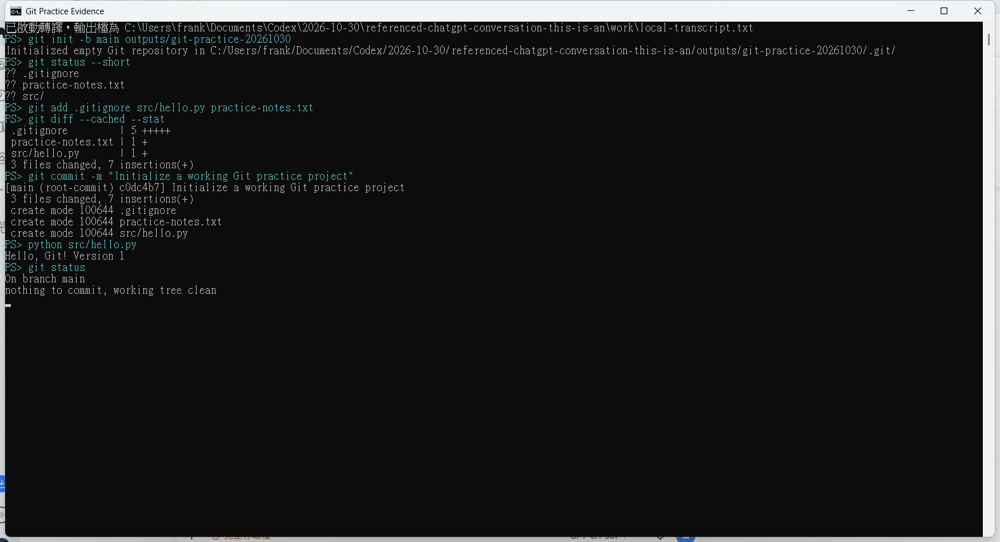
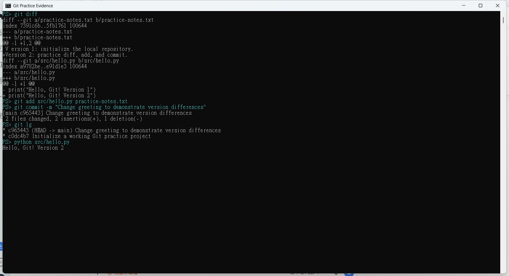
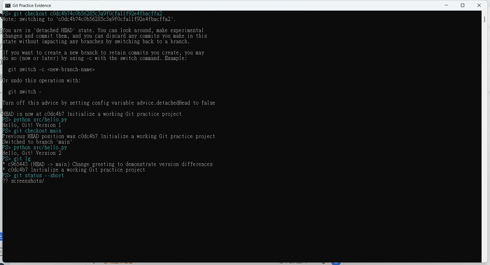
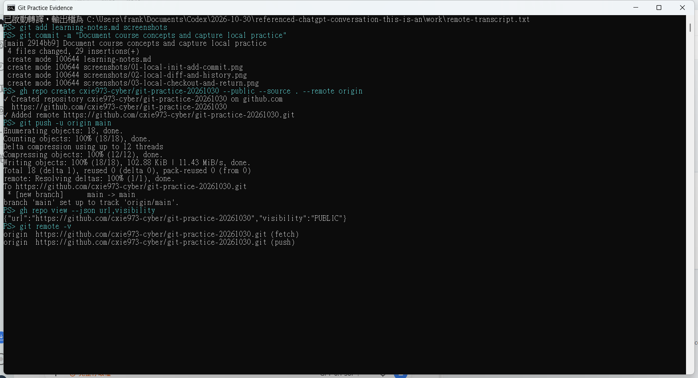
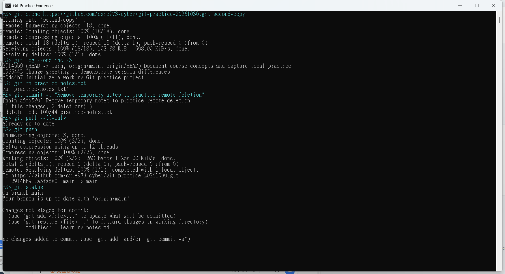
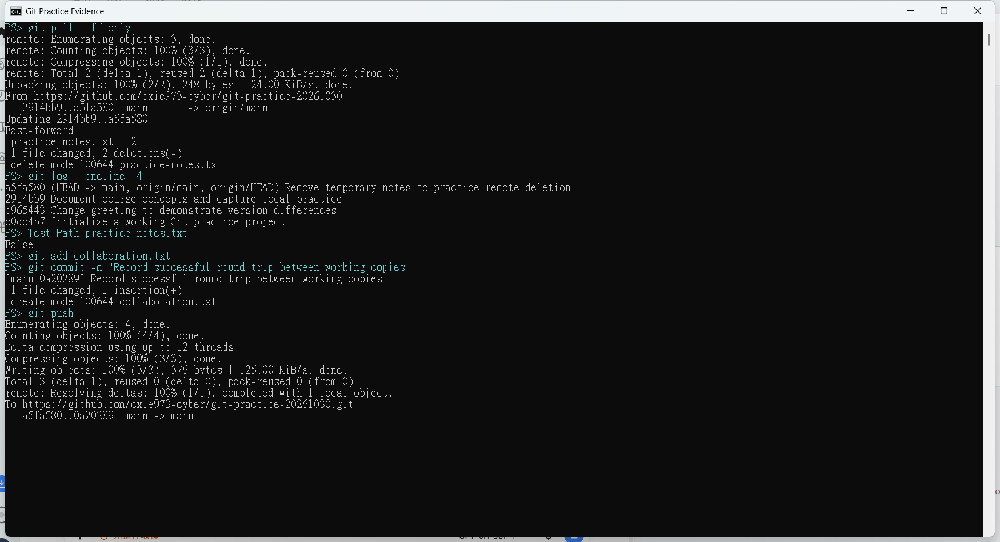
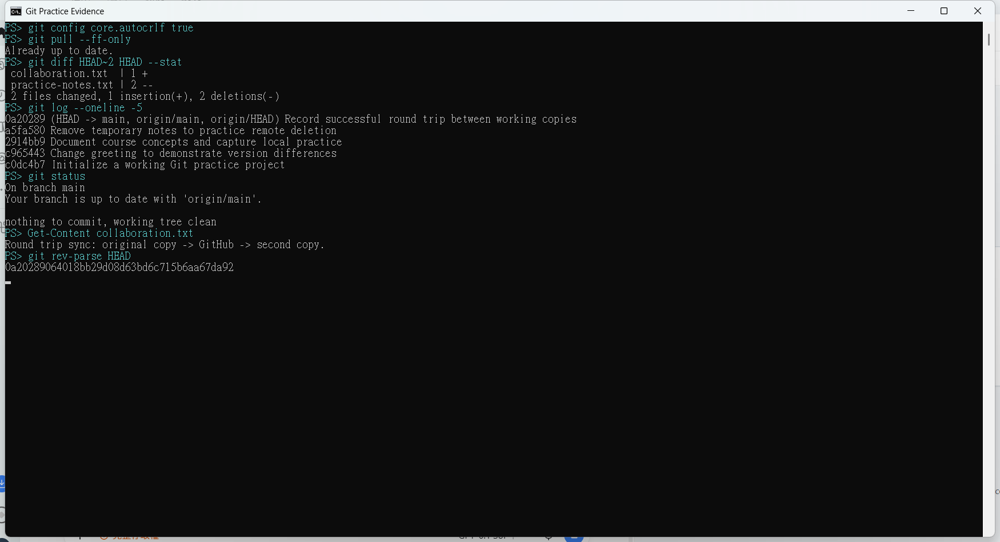

# Git 演練作業

2026-10-30｜本機 Git repository 與 GitHub public repository 實作

本 repository 保存實際執行的 Git 演練成果、提交歷史與七張操作截圖。操作由使用者授權的 Codex 助理在使用者電腦上執行，使用使用者登入的 GitHub 帳號發布。

## 教材

參照 `Git概念介紹.mp4`、`gitLocalRepo演練.mp4` 與 `gitRemote演練.mp4` 的教學畫面與操作流程。各影片的對應位置及概念整理見 [教學筆記](learning-notes.md)。本次以簡單且可執行的 Python 程式作為版本控制素材。

## 已完成的實際操作

1. `git init -b main` 建立全新的本機版本庫，設定 `.gitignore` 與 `lg` 歷史紀錄別名。
2. 使用 `git add` 加入檔案，`git diff --cached --stat` 檢查暫存內容，`git commit` 建立第一版。
3. 將程式從 Version 1 修改為 Version 2，以 `git diff` 比較修改，再提交第二版並查看 `git lg`。
4. `git checkout <第一版 commit>` 後執行程式確認 Version 1，再 `git checkout main` 返回並確認 Version 2。
5. 在已登入的 GitHub 帳號建立全新 **public** repository，設定 `origin` 並 `git push -u origin main`。
6. `git clone` 到另一個本機目錄，刪除暫時筆記檔並提交，先 `git pull --ff-only` 再 `git push`。
7. 原本工作目錄 `git pull --ff-only`，確認刪除已同步；新增同步紀錄，提交後推送。
8. 第二份副本再次 `git pull --ff-only`，以 `git diff`、`git log` 和 `git status` 確認來回同步結果。

兩份本機副本使用同一個 GitHub 帳號，模擬不同工作目錄的同步；沒有虛構其他協作者。

## 真實操作截圖

以下為執行當下的 Windows 終端機視窗截圖，保留實際命令與輸出。截圖沒有重繪、替換輸出或使用教材畫面充當操作證明。

### 1. 建立本機版本庫、暫存與首次提交

### 2. 修改檔案、比較差異與提交歷史

### 3. 切回舊版，再返回 main 驗證程式

### 4. 建立 GitHub 公開 repository 並首次推送

### 5. Clone 第二份副本，提交刪除並推送

此時 `learning-notes.md` 因第二份副本的換行設定不同顯示為已修改；後續調整 `core.autocrlf` 使其符合 Windows checkout 的換行方式，第 7 張截圖已確認工作目錄乾淨。

### 6. 原副本拉取更新，再提交與推送

### 7. 第二份副本再次拉取並驗證來回同步

## 檔案與驗證

- `src/hello.py`：版本控制練習程式，以 `python src/hello.py` 執行，最後輸出 `Hello, Git! Version 2`。
- `collaboration.txt`：兩份副本來回同步的紀錄。
- `learning-notes.md`：影片教學位置、概念與本次操作對應。
- `screenshots/`：七張實際操作畫面。
- `evidence-sha256.txt`：截圖的 SHA-256，方便檢查檔案完整性。

完整的修改順序、刪除筆記檔及各次推送的提交，可在 GitHub 的 commit 歷史中查核。教學影片本身未上傳。
